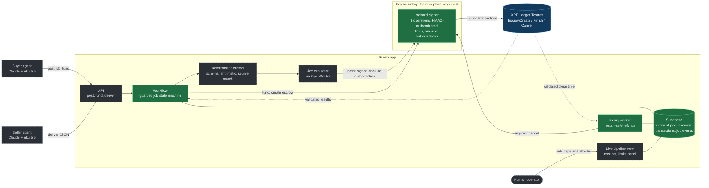
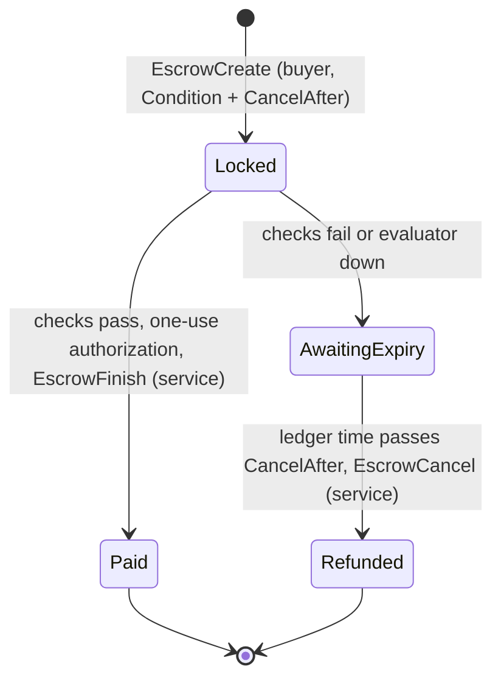

# Surety architecture

Surety lets one AI agent pay another for work, with the money held in native XRP Ledger escrow until the work is verified. The ledger enforces the money rules; Surety's gate decides whether the work is good; only an isolated signer can move funds.

Green is built and proven on testnet. Dashed is planned for the rest of the hackathon.

## Trust boundaries

- **Keys live only in the signer.** It is a separate process on 127.0.0.1 with its own secrets file, and it is the only code that ever loads a seed. A repo-wide lint (`pnpm check:boundaries`) flags known key-handling calls and secret variable names anywhere else. It catches mistakes, not a determined bypass; the separate process and secrets file are the real boundary.
- **The signer accepts three operations, nothing else.** Create escrow for a job, finish with a one-use authorization, cancel an expired escrow. There is no endpoint that signs an arbitrary transaction.
- **Limits are enforced outside the agents.** The signer checks the per-job cap and the destination allowlist on every create, and checks the authorization against the escrow on the validated ledger before every finish.
- **Payment needs a secret only the signer holds.** Each escrow is locked with a PREIMAGE-SHA-256 condition. The matching fulfillment is encrypted at rest and only released on chain inside an authorized EscrowFinish.
- **Ledger time decides, not laptop time.** Finish is refused close to expiry and cancel is refused before expiry, both by validated ledger close time.
- **Validated `tesSUCCESS` is the only success.** Transaction hashes are journaled before submission, so a timeout is resolved by lookup and never by signing twice.
- **The database mirrors; the ledger decides.** Every job state change goes through one guarded transition: it checks the allowed-transition map, updates only if the row is still in the expected state, and appends a `job_events` row in the same database transaction. `job_events` is append-only (a trigger refuses UPDATE and DELETE). `PAID`, `REFUNDED` and `CREATE_FAILED` are terminal; `RECONCILIATION_REQUIRED` freezes a job until a person looks.
- **Refunds survive restarts.** The expiry worker holds nothing in memory. It sweeps on boot and every few seconds for funded jobs whose escrow is past `CancelAfter` by validated ledger close time, and asks the signer to cancel. Operation ids are derived from the job id, so a restarted worker sends the same id and the signer replays its journaled outcome instead of signing again. A signer that is unreachable or still waiting leaves the job `CANCEL_PENDING` for the next sweep; an escrow that is already gone or does not match sends the job to `RECONCILIATION_REQUIRED`, never to `REFUNDED`.

What the ledger does not do: it does not understand the work. A compromised gate or signer could still release wrongly. That is why the gate is layered (rules first, then Jev, both fail closed) and why every release carries a binding to the exact job, deliverable and policy version.

## Escrow lifecycle

