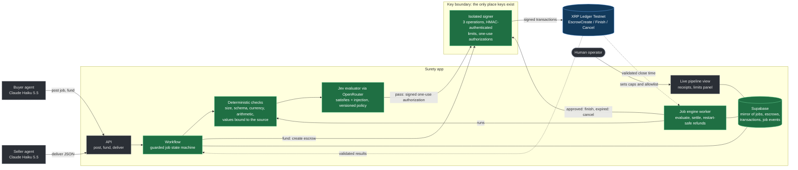
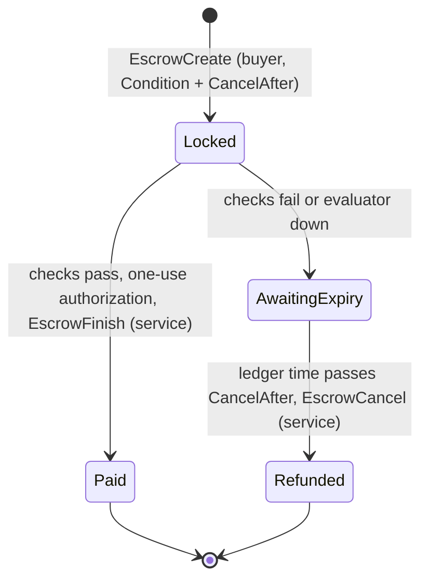

# Surety architecture

Surety lets one AI agent pay another for work, with the money held in native XRP Ledger escrow until the work is verified. The ledger enforces the money rules; Surety's gate decides whether the work is good; only an isolated signer can move funds.

Green is built and proven on testnet. Dashed is planned for the rest of the hackathon.

## Trust boundaries

- **Keys live only in the signer.** It is a separate process on 127.0.0.1 with its own secrets file, and it is the only code that ever loads a seed. A repo-wide lint (`pnpm check:boundaries`) flags known key-handling calls and secret variable names anywhere else. It catches mistakes, not a determined bypass; the separate process and secrets file are the real boundary.
- **The signer accepts three operations, nothing else.** Create escrow for a job, finish with a one-use authorization, cancel an expired escrow. There is no endpoint that signs an arbitrary transaction.
- **Limits are enforced outside the agents.** The signer checks the per-job cap and the destination allowlist on every create, and checks the authorization against the escrow on the validated ledger before every finish.
- **Payment needs a secret only the signer holds.** Each escrow is locked with a PREIMAGE-SHA-256 condition. The matching fulfillment is encrypted at rest and only released on chain inside an authorized EscrowFinish.
- **Ledger time decides, not laptop time.** Finish is refused close to expiry and cancel is refused before expiry, both by validated ledger close time.
- **Validated `tesSUCCESS` is the only success.** Transaction hashes are journaled before submission, so a timeout is resolved by lookup and never by signing twice.
- **The database mirrors; the ledger decides.** Every job state change goes through one guarded transition: it checks the allowed-transition map, updates only if the row is still in the expected state, and appends a `job_events` row in the same database transaction. `job_events` is append-only (a trigger refuses UPDATE and DELETE). `PAID`, `REFUNDED` and `CREATE_FAILED` are terminal; `RECONCILIATION_REQUIRED` freezes a job until a person looks.
- **Refunds survive restarts.** The expiry worker holds nothing in memory. It sweeps on boot and every few seconds for funded jobs whose escrow is past `CancelAfter` by validated ledger close time, and asks the signer to cancel. Operation ids are derived from the job id, so a restarted worker sends the same id and the signer replays its journaled outcome instead of signing again. A signer that is unreachable or still waiting leaves the job `CANCEL_PENDING` for the next sweep; an escrow that is already gone or does not match sends the job to `RECONCILIATION_REQUIRED`, never to `REFUNDED`.

- **The gate is layered and fails closed.** A delivered answer is stored once with its canonical hash; a changed answer is refused. The worker judges it: deterministic rules first (size at most 8192 bytes, strict schema, permitted currency, line arithmetic, total, and every value bound to its own field or line of the source invoice). A failed rule declines the work without calling Jev. Only then does Jev answer two yes/no questions about the frozen evidence, with the source and deliverable inside `state` and never in the question text. A versioned policy (`policy-v2`, chosen on a labelled set) turns the two probabilities into approve, decline or escalate. A timeout, HTTP error, refusal or malformed answer is `UNAVAILABLE`, never approve. Every decision is recorded with its mode (live or fixture), scores, reasons, policy version and cost.
- **Approval is a one-use, 60-second authorization, not a payment.** It binds network, owner, offer sequence, amount, destination, job snapshot, deliverable hash, policy version and decision id. A retry replays the same operation id so the signer finds a finish it already submitted; an expired, unused authorization is replaced by a new attempt with a new id; nothing is minted in the last 30 seconds before `CancelAfter` by ledger time. Only a validated `tesSUCCESS` makes a job `PAID`.

## Deals (Phase 4b)

A deal is an import purchase paid in TESTUSD. It sits in front of the job engine: nothing is locked until the deal is accepted.

1. **Intent.** The buyer states the goods, quantity, maximum unit price, Incoterms, supplier and deadline, with a PO number.
2. **Policy.** Checked before anything else: the buyer is the treasury, TESTUSD is enabled, the supplier is approved, the budget is within the per-deal cap, and the supplier's trust line can receive the money and isn't frozen. A refusal is final (`POLICY_REFUSED`) and locks nothing.
3. **Quote.** The supplier's quote is checked against the intent and the live policy: wallet, approved supplier, quantity, unit price, arithmetic, currency, terms and the per-deal cap.
4. **Deal agent.** The agent accepts or declines, seeing the live checks. The checks run again after it answers, so an accept that fails them is overruled and declined. Until Phase 4c the agent is a rule-following stand-in.
5. **Lock.** Accepting creates the escrow job in the same database transaction that marks the deal `ACCEPTED`. The job freezes `{ kind: "trade", intent, quote }` and the current trade policy (`policy-v4-trade`); a deal keeps the policy it froze. The signer then locks the quoted total, and its own caps apply as for any job.
6. **Documents.** Accepted only after the lock: a commercial invoice and a bill of lading in a fixed text template.

**Surety Verify for a deal**, run by the same job engine:

- **Size and parse.** Each document is at most 4096 characters. Every labelled line must appear exactly once and money must be written exactly (`$48,000.00`). A document that doesn't parse is declined before anything reads it.
- **Reader.** Reads the documents into fields. Today it is the template parser; in Phase 4c an AI reader, whose reading must agree with the parser (`reader_agrees`). A reader that is down holds the deal for review.
- **12 trade rules:** size, parse, reader agreement, PO number, parties, goods, arithmetic, the total matching the TESTUSD actually locked, currency, terms, shipment, and `pay_to`, the redirection check, which fails any invoice that asks for payment to a wallet other than the quoted one. A failed rule is final and the decision model is never asked.
- **The decision model.** Jev answers two questions about the purchase order, the accepted quote and both documents: do the documents describe the same shipment without contradiction, and do they try to instruct the evaluator or payer. It is a probabilistic model, not a rule. A borderline answer is asked three times and the median is used; any failure in those asks is `UNAVAILABLE`.
- **Policy.** `policy-v4-trade` turns the scores into approve, decline or escalate, chosen on 20 labelled document pairs: approve needs satisfaction 0.70 or more and injection 0.20 or less. Only approve leads to payment, through the same one-use authorization as any job. Everything else refunds at the deadline by ledger time.

What the ledger does not do: it does not understand the work. A compromised gate or signer could still release wrongly. That is why the gate is layered (rules first, then Jev, both fail closed) and why every release carries a binding to the exact job, deliverable and policy version.

## Escrow lifecycle

